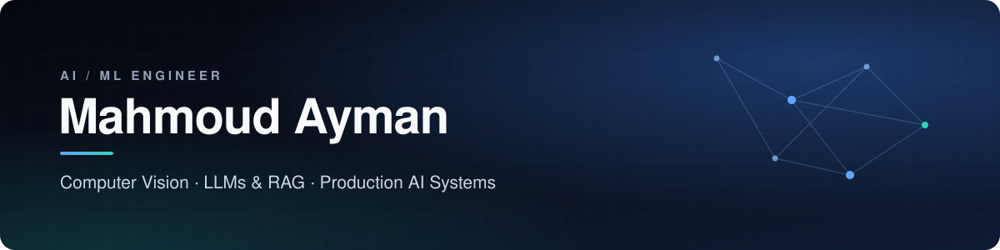
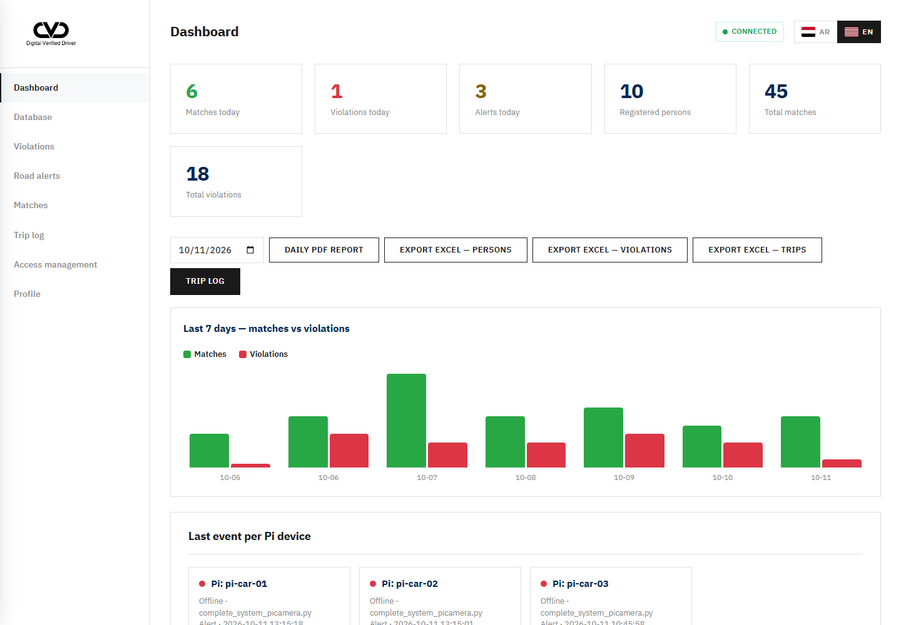
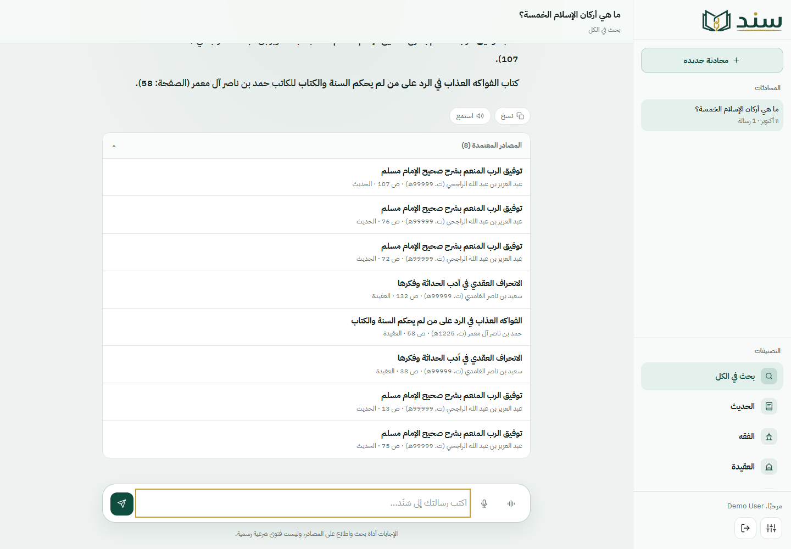

  

  
  
  
  

<h3 align="center">I turn AI research into production systems - from edge devices and model pipelines to secure APIs and the interfaces people actually use.</h3>

 

I'm an **AI & Machine Learning Engineer** based in Cairo, Egypt, and a 2026 graduate in **Electronics & Communication Engineering**. I work across **computer vision**, **NLP / LLMs**, **agentic AI** and **full-stack AI products**, and have delivered **100+ freelance and production projects** for clients in Saudi Arabia, Canada and worldwide.

- **Vision** - face verification, detection, OCR and real-time inference on edge hardware (Raspberry Pi, ONNX).
- **Language & agents** - RAG pipelines with vector databases, multi-agent systems (Google ADK, LiteLLM, MCP), grounded answers.
- **Product** - FastAPI / Flask / NestJS backends, Next.js frontends, PostgreSQL, MongoDB, Redis, Docker.

> 🏆 **2nd Place - Electrical Engineering Division**, Engineers Syndicate Innovation & Graduation Projects Forum 2026, for *Digital Verified Driver*.

 

## Featured work

<table>
  <tr>
    <td width="50%" valign="top">
      
      <h3><a href="https://github.com/mahmoud-aymann/DVD-Digital-Verified-Driver">DVD - Digital Verified Driver</a></h3>
      
<b>🏆 2nd Place - Engineers Syndicate Forum 2026.</b> Team graduation project for real-time driver identity verification. An in-car Raspberry Pi runs YOLOv5 + CNN plate OCR at the edge; the server verifies the driver's face with InsightFace (ArcFace embeddings), flags violations, and maps GPS-tagged road hazards on a bilingual command dashboard.

      
<code>InsightFace</code> <code>YOLOv5</code> <code>PyTorch</code> <code>ONNX</code> <code>Raspberry Pi</code> <code>FastAPI</code> <code>MongoDB</code>

      Partial source (API, dashboard, docs) · core AI withheld · full source on request
    </td>
    <td width="50%" valign="top">
      
      <h3><a href="https://github.com/mahmoud-aymann/Islamic-Knowledge-RAG-Chatbot">Sanad - Islamic Knowledge RAG</a></h3>
      
Arabic-first RAG assistant grounded in a library of ~80k passages. Every answer cites book, author and page, and the system declines when no reliable source passes the similarity threshold - no hallucinated references.

      
<code>RAG</code> <code>FastAPI</code> <code>PostgreSQL + pgvector</code> <code>Celery</code> <code>Redis</code> <code>LLMs</code> <code>Docker</code>

      Partial source (API skeleton, auth, frontend) · RAG core withheld · full source on request
    </td>
  </tr>
</table>

<table>
  <tr>
    <td width="33%" valign="top">
      <b><a href="https://github.com/mahmoud-aymann/blood_cell_prediction">Blood Cell Prediction</a></b> 
      Medical-imaging classifier with web UI, REST API and Docker deployment. 
      <code>PyTorch</code> <code>Flask</code> <code>OpenCV</code>
    </td>
    <td width="33%" valign="top">
      <b>PPE Monitoring</b> · private 
      Computer-vision PPE compliance detection for oil &amp; gas drilling sites. 
      <code>Object detection</code> <code>Industrial safety</code>
    </td>
    <td width="33%" valign="top">
      <b>Nurvia</b> · private 
      Full-stack web platform. 
      <code>NestJS</code> <code>Next.js</code> <code>PostgreSQL</code> <code>Redis</code>
    </td>
  </tr>
</table>

<b>More public projects</b>

 

| Project | Focus |
|---|---|
| [Question-Answering-with-Transformers](https://github.com/mahmoud-aymann/Question-Answering-with-Transformers) | Extractive QA with Transformers fine-tuned on SQuAD |
| [insightface-flask-app](https://github.com/mahmoud-aymann/insightface-flask-app) | Face recognition with InsightFace + Flask |
| [Resume-Screening-Using-NLP](https://github.com/mahmoud-aymann/Resume-Screening-Using-NLP) | NLP resume screening |
| [AI-Travel-Agent-Flask](https://github.com/mahmoud-aymann/AI-Travel-Agent-Flask) | LLM-powered travel assistant |
| [News Headline Classifier](https://github.com/mahmoud-aymann/-News_Headline_Classifier) | Headline classification with scikit-learn + Gradio |
| [Sentiment_Analysis_on_Product_Reviews](https://github.com/mahmoud-aymann/Sentiment_Analysis_on_Product_Reviews) | Sentiment analysis on product reviews |
| [Build-a-Neural-Network-from-Scratch](https://github.com/mahmoud-aymann/Build-a-Neural-Network-from-Scratch) | Neural network from first principles |

 

## Experience

| Role | Company | Period |
|---|---|---|
| **AI Engineer** · part-time, remote | UQAB (Riyadh, Saudi Arabia) | Mar 2026 - Present |
| **Freelance Web Developer & Jr. ML Engineer** | Upwork · Khamsat · Mostaql | Jan 2022 - Present |
| **Agentic AI Intern** · remote | Netpoint | Jul 2026 - Aug 2026 |
| **NLP Intern** · remote | Elevvo | Feb 2026 - Mar 2026 |
| **Co-Founder & AI Engineer** · part-time, remote | Swift Technology (Ontario, Canada) | Nov 2023 - Jul 2026 |

<b>Highlights</b>

 

- **UQAB** - built and optimised AI solutions for computer vision, real-time analytics and automation; integrated TensorFlow / PyTorch models with backend APIs.
- **Netpoint** - multi-agent systems with Google ADK, orchestrated with LiteLLM, FastAPI and Redis; custom MCP servers and Langfuse observability.
- **Elevvo** - sentiment analysis, question answering (SQuAD) and resume screening, served through Flask / Express APIs.
- **Freelance** - 100+ projects for Saudi and international clients, from ML prototypes to production websites.

 

## Education & recognition

| | |
|---|---|
| 🎓 **B.Sc. Electronics & Communication Engineering** - Al Safwa High Institute of Engineering and Technology | Aug 2021 - Jul 2026 · Very Good |
| 📘 **AI & Machine Learning Diploma** - AMIT Learning | Dec 2024 - Dec 2025 |
| 🥈 **2nd Place**, Electrical Engineering Division - Engineers Syndicate Innovation & Graduation Projects Forum | 2026 |
| 🚀 **Finalist** - Under 30 Competition (Masar Ventures, Zewail City) | 2026 |
| 🏅 **Winner** - TechMakers Challenge · AI & IoT Challenge | 2026 |
| 💡 **Graduation Project Grant** - Innovators Care Fund (ICF) | 2026 |

**Certifications:** NVIDIA - Building LLM Applications With Prompt Engineering · NVIDIA DLI Generative AI (ITI) · IBM / Coursera - Artificial Intelligence Engineer 1 badge, Machine Learning with Python, Deep Learning with Keras and TensorFlow, Introduction to Neural Networks and PyTorch · DataCamp - GitHub Foundations

 

## Toolkit

<table>
  <tr>
    <td width="150"><b>AI / ML</b></td>
    <td>         </td>
  </tr>
  <tr>
    <td><b>Backend &amp; data</b></td>
    <td>    </td>
  </tr>
  <tr>
    <td><b>Frontend</b></td>
    <td></td>
  </tr>
  <tr>
    <td><b>Infra &amp; edge</b></td>
    <td></td>
  </tr>
</table>

 

## Currently

- **AI Engineer at UQAB** - computer vision, real-time analytics and automation.
- Building **RAG** and **agentic AI** systems, and taking *Digital Verified Driver* further.
- Open to roles and engagements in **Canada, Saudi Arabia and worldwide**.

 

## GitHub

  
  

 

## Let's talk

Based in Cairo, Egypt · open to opportunities in Canada, Saudi Arabia and worldwide - full-time roles, freelance projects and collaborations in AI, computer vision and LLM engineering. Source code for withheld or private projects is available to recruiters and companies on request.

  
  

